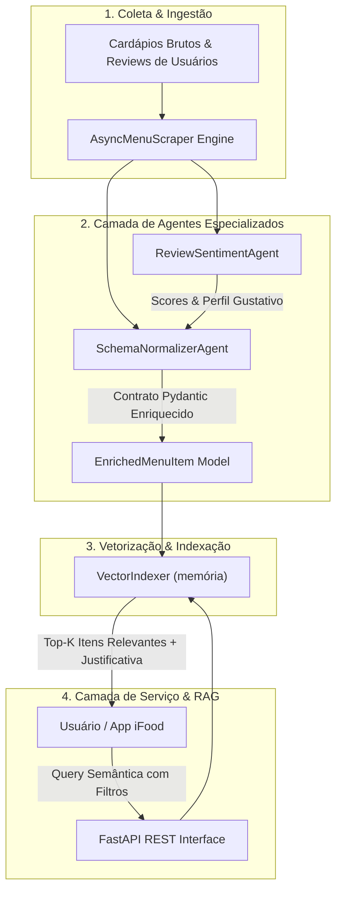

# 🍽️ iFood Smart Ingestion Agent (Multi-Agent RAG Pipeline)

[](https://www.python.org/)
[](https://fastapi.tiangolo.com/)

[](tests/)
[](LICENSE)

> **Pipeline multi-agente para enriquecimento de catálogos gastronômicos, inferência de alérgenos/dietas e busca textual por similaridade em memória.**

Para uma explicação arquivo a arquivo da estrutura, dos fluxos e das limitações atuais, consulte [PANORAMA_ARQUIVOS_E_CODIGO.md](./PANORAMA_ARQUIVOS_E_CODIGO.md).

---

## 🎯 Contexto & Impacto de Negócio (iFood AI-First)

Milhares de novos restaurantes ingressam no ecossistema de delivery com cardápios não estruturados, textos ruidosos, descrições ausentes e informações críticas de saúde pública omitidas (como alérgenos e restrições alimentares).

Este projeto resolve esse gargalo através de um **Pipeline Inteligente Multi-Agente**:
1. **Redução drástica do Time-to-Market de novos parceiros:** ingestão automatizada de cardápios via scraping inteligente e parsing semântico.
2. **Segurança Alimentar do Consumidor:** inferência e rotulagem preventiva de alérgenos (glúten, laticínios, crustáceos) e restrições (vegano, sem glúten, low carb).
3. **Conversão de Vendas com Busca Semântica (RAG):** substituição de buscas rígidas por palavras-chave por busca vetorial semântica (ex: *"quero prato com cogumelos trufados até R$70"*).

---

## 🏗️ Arquitetura do Sistema



---

## 📦 Estrutura do Repositório

```text
├── app.py                      # Servidor FastAPI com rotas REST de ingestão e busca semântica
├── requirements.txt            # Dependências de produção
├── requirements-dev.txt        # Ferramentas de desenvolvimento e testes
├── Dockerfile                  # Conteinerização otimizada
├── docker-compose.yml          # Execução do app
├── tools/
│   ├── security_scan.py        # Análise estática e auditoria de dependências
│   ├── quality_scan.py         # Lint, verificação de tipos e testes
│   └── ingestion_scan.py       # Verificação funcional do pipeline de ingestão
├── src/
│   ├── compat.py               # Compatibilidade resiliente (Pydantic v2 + fallback nativo)
│   ├── models.py               # Schemas tipados e contratos de dados
│   ├── pipeline.py             # Orquestrador do fluxo ponta a ponta
│   ├── scraper/
│   │   └── async_scraper.py    # Motor de coleta com controle de concorrência
│   ├── agents/
│   │   ├── schema_normalizer.py    # Normalização de preços, porções e alérgenos
│   │   └── review_sentiment_agent.py # Mineração de sentimentos e atributos culinários
│   └── vector_store/
│       └── vector_indexer.py   # Busca em memória por similaridade de cossenos
└── tests/
    └── test_pipeline.py        # Suíte de testes unitários e de integração
```

---

## 🚀 Como Executar

### 1. Clonar e Executar Localmente
```bash
# Clone o repositório
git clone https://github.com/lucasocp/ifood-smart-ingestion-agent.git
cd ifood-smart-ingestion-agent

# Instale dependências de desenvolvimento e testes
python -m pip install -r requirements-dev.txt

# Execute a suíte de testes automatizados
python -u tests/test_pipeline.py

# Execute o pipeline interativo
python -u src/pipeline.py
```

### 2. Executar via Docker Compose
```bash
docker compose up --build
```
A API estará disponível em `http://localhost:8000` (documentação interativa Swagger em `http://localhost:8000/docs`).
O índice é mantido em memória e reconstruído quando a aplicação inicia.

### 3. Scanner de segurança
Instale as ferramentas de desenvolvimento e execute as verificações locais:
```bash
python -m pip install -r requirements-dev.txt
python tools/security_scan.py
```
O scanner usa Bandit para analisar o código Python e pip-audit para verificar as dependências de produção.

### 4. Scanner de qualidade
Com as dependências de desenvolvimento instaladas, execute:
```bash
python tools/quality_scan.py
```
O scanner executa Ruff, mypy e os testes unitários.

### 5. Scanner funcional de ingestão
Valide localmente o pipeline com o catálogo de demonstração:
```bash
python tools/ingestion_scan.py
```
O scanner verifica a ingestão, preços, alérgenos e buscas com filtros, sem acessar serviços externos.

---

## 🧪 Exemplos de Casos de Teste Atendidos

| Query do Usuário | Filtro Aplicado | Item Retornado | Score de Relevância |
| :--- | :--- | :--- | :--- |
| *"comida vegana saudável com tofu"* | N/A | **Super Bowl Proteico Vegano Zen** | **0.1164** |
| *"fettuccine queijo cogumelos"* | `max_price <= R$ 70,00` | **Fettuccine Alfredo c/ Cogumelos Trufados** | **0.7685** |
| Detecção de Risco Alimentar | Acarajé Baiano | **Detecta Alérgenos: Frutos do Mar & Dendê** | **Alta Confiança** |

---

## 👨‍💻 Autor

**Lucas Oliveira Costa Pinto**  
- **LinkedIn:** [linkedin.com/in/lucas-oliveira-costa-pinto](https://www.linkedin.com/in/lucas-oliveira-costa-pinto/)  
- **GitHub:** [github.com/lucasocp](https://github.com/lucasocp)  
